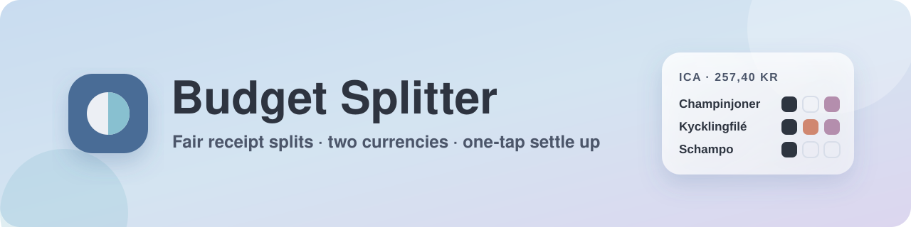
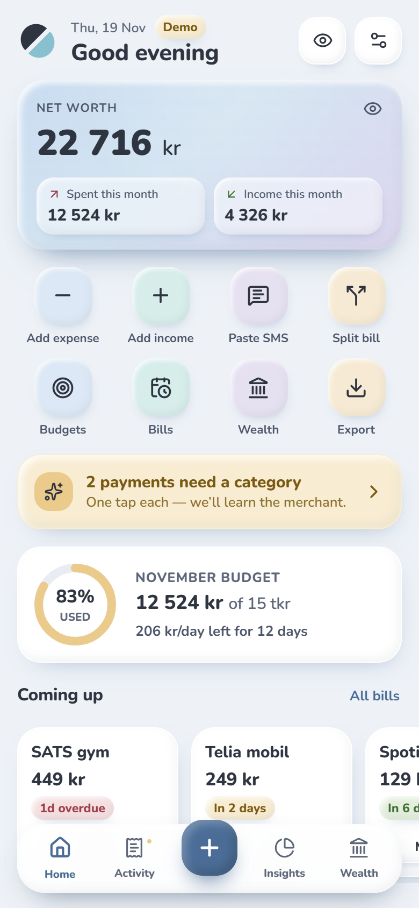
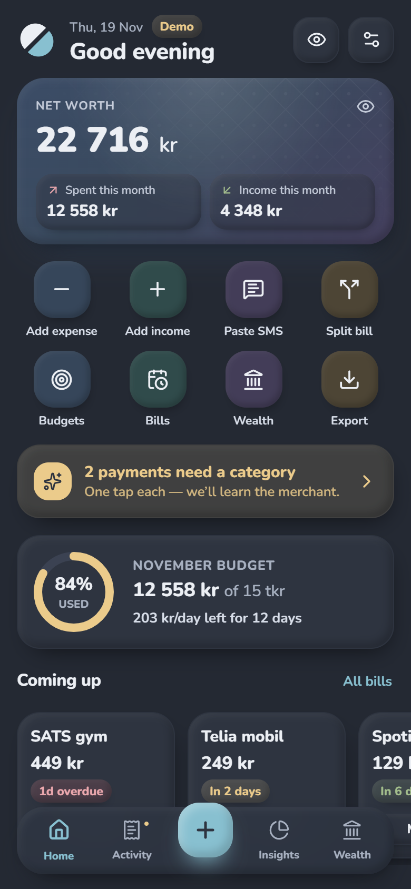
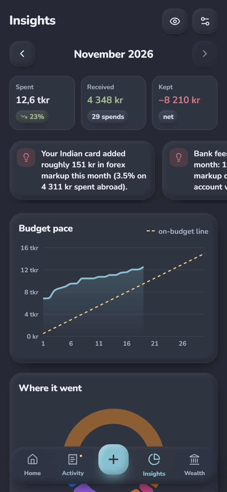
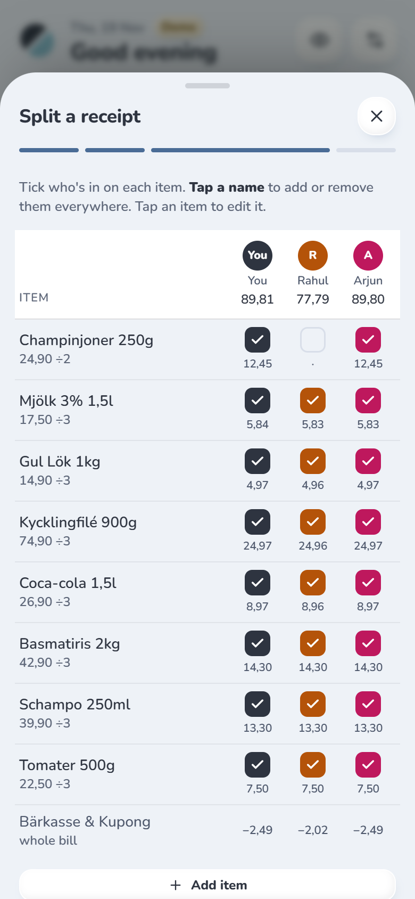
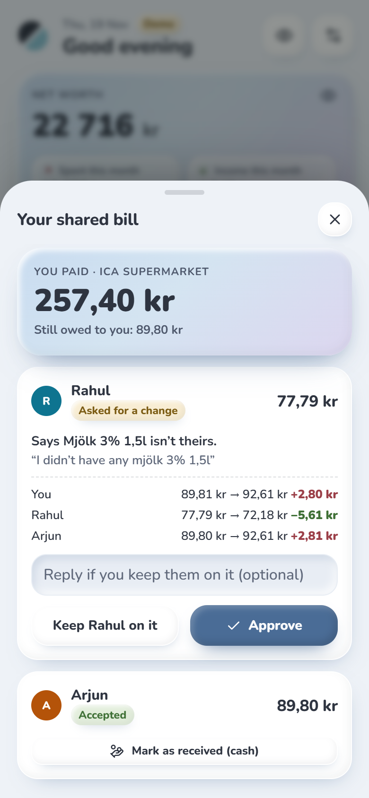
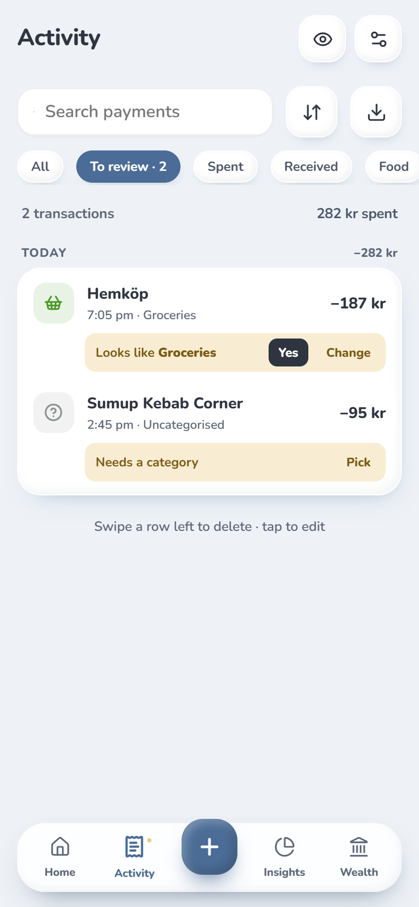
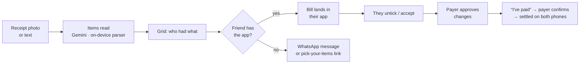

<div align="center">



<br />

**A personal-finance PWA for an Indian living in Sweden, with fair, item-by-item bill splitting for roommates.**

<sub><i>Kvitto</i> is Swedish for receipt.</sub>

<br />


[Features](#features) · [Screenshots](#screenshots) · [How it works](#how-it-works) · [Tech](#tech-stack) · [Run it](#run-it-locally)

</div>

<br />

## Why I built it

Grocery runs with roommates always ended in the same argument: *"I don't eat mushrooms, why am I paying for them?"* Splitting the total equally is unfair, and splitting by hand is tedious.

Splitkvitto reads the receipt, lets everyone tick only what's theirs, and sends each roommate their exact share straight into their own app. It's precise to the öre, including bag fees, coupons and bottle deposits. Around that sits a full finance tracker built for life abroad: an Indian bank card used in Sweden, money in two currencies, and bank SMS that log themselves.

<br />

## Screenshots

<div align="center">
<table>
  <tr>
    <td align="center"><br /><sub><b>Home</b> · light</sub></td>
    <td align="center"><br /><sub><b>Home</b> · dark</sub></td>
    <td align="center"><br /><sub><b>Insights</b> · budget pace</sub></td>
  </tr>
  <tr>
    <td align="center"><br /><sub><b>Split a receipt</b> · no mushrooms for Rahul</sub></td>
    <td align="center"><br /><sub><b>Shared bill</b> · approve a change</sub></td>
    <td align="center"><br /><sub><b>Activity</b> · one-tap review</sub></td>
  </tr>
</table>
</div>

<br />

## Features

### Split receipts item by item
- **Scan, paste or type** a receipt. Gemini vision reads photos, and Swedish receipt text (ICA, Willys, Lidl, Coop) is parsed on the device.
- **Scan several receipts at once**, then merge them into one bill or go through them as separate bills.
- An **items × people grid** shows every share live. Tap a name to add or remove that person on every item.
- **Fair to the öre:** uneven splits ("2 of 3 packs"), discounts follow what each person bought, bags are shared only by people who bought something, and bottle deposits follow their drink. Totals always match the receipt.

### Shared bills between accounts
- **Connect by email.** Friend requests are accepted in the app.
- **Send a bill into a friend's app.** They review it, untick anything that isn't theirs, and accept or decline.
- **The payer approves every change**, with a before-and-after for everyone it affects, so nobody can quietly lower their own share.
- **Paid takes both sides:** "I've paid" only counts once the payer confirms it.
- Friends without an account still get a WhatsApp-ready message or a tick-your-items link.

### Built for life abroad
- **Multi-currency:** totals are shown in SEK, every payment keeps its own currency, and live ECB exchange rates are used.
- **Bank SMS log themselves:** an iPhone Shortcut or Android automation sends each SMS to the app, which picks out the foreign amount, the merchant and the card fees.
- **Forex insight:** shows what your Indian card's markup cost you this month.
- **Swedish merchants are recognised automatically**, from ICA to SL to Systembolaget.

### Everyday money
- One-tap category review, merchant rules, budgets with per-category caps, and a budget-pace chart.
- Bills and subscriptions, savings goals, fixed deposits, debts, and net worth.

### Accounts & privacy
- Invite-only accounts, with an admin portal to add, pause and reset people.
- **Row Level Security:** everyone sees only their own data, and the admin never sees amounts.
- An optional per-device PIN lock and a hide-balances mode.

### Design
- **"Sorbet Nord":** puffy pastel clay shapes on Nord frost blues, in matching light and dark themes (choose Auto, Light or Dark).
- Spring physics throughout: squishy presses, drag-to-dismiss sheets and number roll-ups, and all of it respects *reduce motion*.

<br />

## How it works



All sharing goes through one server endpoint (`/api/shared`) that enforces the rules: only connected friends, only the payer approves changes, and nothing is settled without both people. The database can't be read or written directly from the app.

<br />

## Tech stack

| Layer | Tools |
|---|---|
| **App** | React 19 · TypeScript · Vite · Motion (springs, gestures) · Recharts · Lucide |
| **Data & auth** | Supabase Postgres · Supabase Auth · Row Level Security · Realtime |
| **Server** | Cloudflare Pages Functions (`frontend/functions/api/*`): SMS ingest, admin, receipt reading, share links, shared bills |
| **AI** | Gemini 2.5 Flash for receipt photos and category suggestions |
| **Phone** | Installable PWA with an offline service worker; iOS Shortcuts / Android MacroDroid for SMS |
| **Tests** | 5 Node test suites (`npm test`): splitting maths, receipts, SMS pipeline, admin rules, shared bills |

<br />

## Run it locally

Demo mode needs no database. It loads two months of sample data and pretend roommates who answer your bills.

```bash
cd frontend
npm install
npm run dev
```

Then open http://localhost:5173/?demo=1.

<details>
<summary><b>With your own Supabase project</b></summary>

<br />

1. Create a Supabase project, turn **off** public sign-ups, and add your own user (*Authentication → Users*).
2. Run [`supabase/schema.sql`](supabase/schema.sql) in the SQL editor. The first user becomes admin.
3. Copy `frontend/.env.example` to `frontend/.env` and fill in your project URL and **publishable** key.
4. `npm run dev` and sign in.

To deploy, use Cloudflare Pages with root directory `frontend`, build command `npm run build` and output `dist`. Add `SUPABASE_SERVICE_ROLE_KEY` (your **secret** key) as an encrypted variable.

Full guides: [docs/ACCOUNTS.md](docs/ACCOUNTS.md) · [docs/PHONE_SETUP.md](docs/PHONE_SETUP.md) · [supabase/SECURITY.md](supabase/SECURITY.md)

</details>

<details>
<summary><b>Project structure</b></summary>

<br />

```
frontend/
├── functions/api/      Cloudflare endpoints: parse · admin · receipt · bill · shared
├── shared/             logic shared by the app, the server and the tests
│   ├── billSplit.js      item-by-item splitting, exact to the öre
│   ├── sharedBill.js     shared-bill rules (accept, change, approve, paid)
│   ├── friends.js        friends + shared-bills endpoint
│   ├── receipt.js        Swedish receipt parser + merging receipts
│   └── sms.js            bank SMS parser + Swedish merchant hints
├── src/
│   ├── pages/            Home · Activity · Insights · Wealth
│   ├── components/       sheets, tab bar, balance card, motion primitives
│   ├── admin/            admin portal
│   └── lib/              auth, money & FX, splits, shared-bills client, demo data
└── scripts/            test suites
supabase/               schema.sql (tables + RLS), SECURITY.md
docs/                   setup guides, screenshots
```

</details>

<br />

## Security

- **Sign-in** uses Supabase Auth, and Row Level Security on every table limits data access.
- **The service-role key stays on the server** (Cloudflare encrypted variables) and never ships in the app.
- **Only hashes are stored** for personal SMS keys and share links.

Details: [supabase/SECURITY.md](supabase/SECURITY.md).

<br />

<div align="center">

Made in Sweden, with an Indian bank card

<sub>Personal project · built for portfolio demonstration</sub>

</div>
